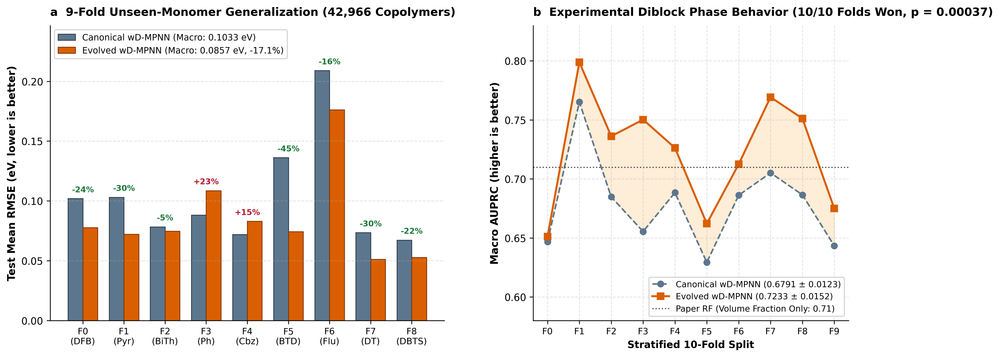
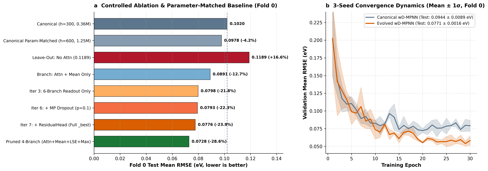
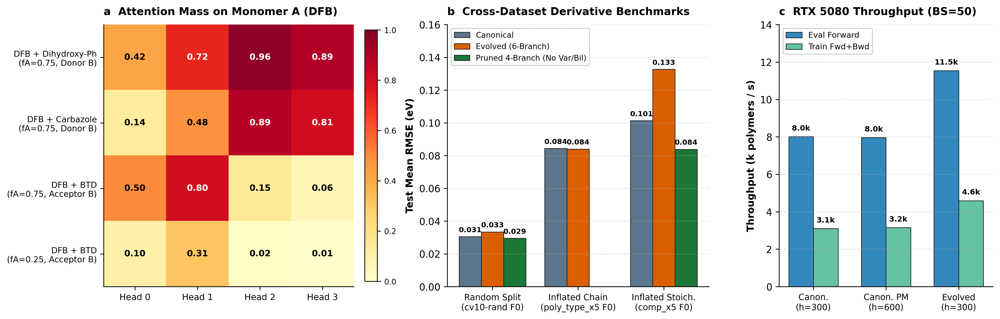

# Synergy-wD-MPNN

**Multi-Scale Non-Linear Polymer Readout and Bidirectional Synergy Aggregation for Out-of-Distribution Copolymer Property Prediction**

[](LICENSE)
[](requirements.txt)
[](requirements.txt)

`Synergy-wD-MPNN` extends the weighted Directed Message Passing Neural Network (`wD-MPNN`) for stochastic and sequence-defined polymers. While canonical `wD-MPNN` performs single-scale stoichiometry-weighted summation over atomic hidden states, this uniform linear pooling blurs frontier electronic extrema (HOMO/IP and LUMO/EA) and attenuates donor-acceptor cross-monomer charge-transfer interactions on unseen monomer scaffolds.

`Synergy-wD-MPNN` replaces uniform linear pooling with a six-branch multi-scale stochastic readout (`synergy6`, plus a compact four-branch pruned variant `attn4`), stochastically regularized message passing (`mp_dropout_p = 0.1`), and a residual skip-connected predictor head (`use_residual_head = True`).



---

## Architecture Overview

Given atom-level hidden states $\mathbf{h}_v$ weighted by stochastic monomer mole fractions $w_v$ and chain-length scaling $(1 + \log_{10} X_n)$, canonical `wD-MPNN` computes a single weighted sum $\mathbf{z}_{\mathrm{mean}} = \sum_v w_v \mathbf{h}_v$.

In `Synergy-wD-MPNN`, stochastic-bond message passing preserves all monomer-interface weightings ($w_{uv}$) with intermediate dropout ($p = 0.1$) and constructs a **6-branch compositional readout** ($6H = 1800$ dims at $H = 300$, down-projected by a learnable projection head into $\mathbb{R}^H$):

1. **Weighted Sum ($\mathbf{z}_{\mathrm{mean}}$)**: Global stoichiometry-weighted bulk representation.
2. **Weighted LogSumExp ($\mathbf{z}_{\mathrm{lse}}$)**: Numerically stabilized soft-maximization preserving minority frontier orbitals.
3. **Weighted Max ($\mathbf{z}_{\mathrm{max}}$)**: Hard extremum pooling capturing dominant local reactive or chromophoric sites.
4. **Weighted Variance ($\mathbf{z}_{\mathrm{var}}$)**: Second-order compositional heterogeneity across co-monomer blocks.
5. **Stoichiometry-Weighted 4-Head Attention ($\mathbf{z}_{\mathrm{attn}}$)**: Learnable multi-head atom selection gated by monomer weight factors.
6. **Bilinear Frontier Synergy ($\mathbf{z}_{\mathrm{syn}}$)**: Cross-branch outer modulation between bulk context and soft-frontier states ($\mathbf{z}_{\mathrm{mean}} \odot \mathbf{z}_{\mathrm{lse}}$).

A linear residual shortcut directly connects $\mathbf{z}_{\mathrm{polymer}}$ to the output prediction alongside the two-layer ReLU feed-forward head.

### Parameter Parity & GPU Throughput (NVIDIA RTX 5080)

| Variant | Trainable Params | Eval Latency (bs=50) | Eval Throughput | Train Latency (bs=50) | Train Peak VRAM |
| :--- | :---: | :---: | :---: | :---: | :---: |
| Canonical `wD-MPNN` (`H=300`) | 355,202 | 6.242 ms | 8,009.9 /s | 16.122 ms | 106.52 MB |
| Canonical Param-Matched (`H=600`) | 1,250,402 | 6.281 ms | 7,960.9 /s | 15.863 ms | 149.25 MB |
| **`Synergy-wD-MPNN`** (`H=300`, `synergy6`) | 1,255,802 | **4.334 ms** | **11,536.3 /s** | **10.894 ms** | 124.22 MB |

---

## Benchmark Performance

### 1. Out-of-Distribution Unseen-Monomer Copolymer Optoelectronics (`cv9-monomer`, 42,966 Copolymers)

| Benchmark / Metric | Canonical `wD-MPNN` (`H=300`) | `Synergy-wD-MPNN` (`H=300`) | Relative Change | Statistical Test (9 Folds) |
| :--- | :---: | :---: | :---: | :--- |
| Macro Mean RMSE (eV) | $0.1033 \pm 0.0451$ | **$0.0857 \pm 0.0379$** | **-17.10%** | paired $t = -2.144, p = 0.0644$ |
| Macro EA vs SHE RMSE (eV) | $0.1012 \pm 0.0290$ | **$0.0764 \pm 0.0163$** | **-24.51%** | paired $t = -3.574, p = 0.0073$ |
| Macro IP vs SHE RMSE (eV) | $0.1055 \pm 0.0685$ | **$0.0950 \pm 0.0654$** | **-9.98%** | paired $t = -0.867, p = 0.4111$ |
| Multi-Seed Fold 0 Mean RMSE (seeds 0,1,2) | $0.0944 \pm 0.0089$ | **$0.0771 \pm 0.0016$** | **-18.27%** | IP Welch $t = -3.441, p = 0.0496$ |

### 2. Controlled Ablation & Parameter-Matched Control (`cv9-monomer` Fold 0, `seed=0`)

| Model Variant | EA RMSE (eV) | IP RMSE (eV) | Mean RMSE (eV) | vs. Canonical |
| :--- | :---: | :---: | :---: | :---: |
| Canonical `wD-MPNN` (`H=300`) | 0.0982 | 0.1059 | 0.1020 | baseline |
| Canonical Param-Matched (`H=600`) | 0.0870 | 0.1086 | 0.0978 | -4.18% |
| + 6-Branch Readout Only (`dropout=0`) | 0.0884 | 0.0712 | 0.0798 | -21.77% |
| + MP Dropout (`p=0.1`) | 0.0894 | 0.0691 | 0.0793 | -22.29% |
| **Full `Synergy-wD-MPNN`** (+ Residual Head) | 0.0841 | 0.0712 | **0.0776** | **-23.92%** |
| Pruned 4-Branch (`attn4`, Attn+Mean+LSE+Max) | **0.0726** | 0.0730 | **0.0728** | **-28.63%** |
| Without Attention (`no_attn`) | 0.1066 | 0.1312 | 0.1189 | +16.56% |

### 3. Experimental Diblock Copolymer Phase Classification (`diblock-phases`, 4,780 Samples, 10-Fold CV)

| Metric | Canonical `wD-MPNN` | `Synergy-wD-MPNN` | Fold Wins | Paired $t$-test |
| :--- | :---: | :---: | :---: | :--- |
| Macro 5-Class AUPRC | $0.6791 \pm 0.0123$ (SEM) | **$0.7233 \pm 0.0152$** (SEM) | **10 / 10** | $t = 5.519, p = 0.00037$ |
| Macro 5-Class ROC-AUC | $0.8945 \pm 0.0052$ (SEM) | **$0.9111 \pm 0.0031$** (SEM) | **10 / 10** | $t = 5.413, p = 0.00043$ |




---

## Repository Structure

```text
Synergy-wD-MPNN/
├── chemprop/                  # Core wD-MPNN library with configurable multi-scale polymer readouts
│   ├── models/mpn.py          # Weighted MPNEncoder + 6-branch synergy6 / 4-branch attn4 readouts
│   └── models/model.py        # MoleculeModel with optional linear residual skip predictor
├── checkpoints/
│   └── synergy_wdmpnn_fold0_seed0.pt   # Pretrained Fold-0 Synergy-wD-MPNN checkpoint (unseen DFB)
├── data/
│   ├── README.md              # Links to full 42,966-copolymer and 4,780-diblock benchmarks
│   ├── sample_copolymers.csv  # 30 conjugated copolymers for smoke tests & inference verification
│   └── sample_diblock.csv     # 30 experimental diblock copolymers with ~Xn degree of polymerization
├── docs/figures/              # Publication-resolution PNG & PDF figures
├── results/                   # Raw 10-fold diblock CV, RTX 5080 profiling, and attention JSON logs
├── scripts/
│   └── profile_throughput.py  # GPU latency and peak VRAM benchmark script
├── tests/
│   └── test_invariance_and_ablation.py  # Unit tests (invariance, DP scaling, param parity, checkpoint)
├── evaluate.py                # Zero-leakage checkpoint evaluation script
├── run_ablation.py            # Controlled ablation runner & trainable parameter counter
├── train.py / predict.py      # Standard Chemprop/wD-MPNN CLI entrypoints
└── requirements.txt
```

---

## Installation & Quick Start

```bash
git clone https://github.com/Ymujiang/Synergy-wD-MPNN.git
cd Synergy-wD-MPNN
pip install -r requirements.txt
```

### 1. Run Unit Tests (Invariance, Parameter Parity, DP Scaling, Checkpoint)

```bash
python -m unittest discover -s tests -v
```

### 2. Inspect Trainable Parameter Counts Across All 12 Ablation Variants

```bash
python run_ablation.py --list_params
```

### 3. Evaluate Pretrained Checkpoint on Sample Unseen Copolymers

```bash
python evaluate.py \
  --checkpoint checkpoints/synergy_wdmpnn_fold0_seed0.pt \
  --test_csv data/sample_copolymers.csv \
  --gpu 0
```

### 4. Profile GPU Latency & Peak Memory

```bash
python scripts/profile_throughput.py --batch_size 50 --gpu 0
```

---

## Citation

If you use `Synergy-wD-MPNN` in your research, please cite the accompanying manuscript and the foundational `wD-MPNN` work:

```bibtex
@article{tian2026synergy,
  title={Resolving Electronic and Morphological Dilution in Polymer Graph Neural Networks via Multi-Scale Stochastic Readout and Frontier Synergy Aggregation},
  author={Tian, Hengyan and Dong, Lina and Yang, Fei and Jiang, Dengbang and Li, Chunyin and Yuan, Minglong},
  journal={Journal of Chemical Theory and Computation},
  year={2026},
  note={Submitted}
}

@article{aldeghi2022graph,
  title={A graph representation of molecular ensembles for polymer property prediction},
  author={Aldeghi, Matteo and Coley, Connor W.},
  journal={Chemical Science},
  volume={13},
  number={35},
  pages={10486--10498},
  year={2022},
  publisher={Royal Society of Chemistry}
}
```

## License

This project is released under the [MIT License](LICENSE), retaining full compatibility with the upstream `chemprop` / `wD-MPNN` codebase.
